<div align="center">

```text
 ____   ____   _____   ___   ____   _ 
|  _ \ / ___| |___ /  / _ \ |___ \ / |
| |_) |\___ \   |_ \ | (_) |  __) || |
|  _ <  ___) | ___) | \__, | / __/ | |
|_| \_\|____/ |____/    /_/ |_____||_|
   > security operations // investigations // detection
```

# Raveena Sharma

**Security Operations Intern · Investigations · Vulnerability Management · Threat Management**


[LinkedIn](https://linkedin.com/in/raveena-sharma-csit) · [TryHackMe](https://tryhackme.com/p/raveenasharma392) · [Email](mailto:raveenasharma3921@gmail.com)

</div>

---

## About Me

I'm a final-year Cyber Security student in Pune who is most interested in the moment after something has gone wrong: working out what happened, how far it spread and what should be done next. I triage alerts, follow evidence through logs and disk images, break things with VAPT tooling, and then build the systems that would have stopped it.

I'm looking for a security operations internship where I can work across investigations, vulnerability management and threat management, and keep learning from people who do this every day.

---

## Case File: RS-3921

> [!IMPORTANT]
> **CASE RS-3921 &nbsp;·&nbsp; STATUS: OPEN** &nbsp;·&nbsp; Subject is actively seeking a security operations internship.

| | |
|---|---|
| **Subject** | Raveena Sharma, B.Tech CS&IT (Cyber Security), Symbiosis Skills and Professional University, Pune (2023 to 2027) |
| **Seeking** | Security operations internship across investigations, vulnerability management and threat management |
| **Most recent assignment** | R&D Lead Intern, OffSecDiary (Jan to Jul 2026) |
| **Current assignment** | Cloud Security & Innovation Lead, AWS Student Builder Club (2026 to 27) |

**Evidence on file**

| Exhibit | Finding | Where to look |
|---|---|---|
| **A** | Designed an enterprise DLP prototype with an ML module that cuts false-positive alerts | [Featured Builds](#featured-builds) |
| **B** | Led a portfolio of 6 security research projects over 7 months | [Journey So Far](#journey-so-far) |
| **C** | Competitive record in CTFs and on TryHackMe | [CTF and Competition Record](#ctf-and-competition-record) |
| **D** | Certifications completed, in progress and being explored | [Certifications and Learning Path](#certifications-and-learning-path) |

---

## My Alert Triage Pipeline

How I work an alert, from first signal to a decision someone can act on:


---

## Skills Mapped to the Attack Lifecycle

I organize what I know the way an adversary operates, so every skill answers a real question: *where does this stop the attacker?*

| Phase | Question I answer | What I use |
|---|---|---|
| **Reconnaissance** | What does the attacker see? | Nmap, Kali Linux, DNS, TCP/IP, HTTP/HTTPS |
| **Vulnerability discovery** | What can be exploited? | Nessus, Burp Suite, OWASP ZAP, OWASP Top 10, risk assessment |
| **Exploitation** | Is it really exploitable? | Metasploit, Hydra, John the Ripper, Hashcat |
| **Detection** | Can we see it happening? | Splunk, IDS/IPS, MITRE ATT&CK, IOC/IOA/TTP analysis, threat hunting fundamentals |
| **Investigation** | What actually happened? | Autopsy, FTK Imager, Wireshark, Windows Event and log analysis |
| **Response** | How do we contain and recover? | Incident response, alert triage, evidence preservation |
| **Prevention** | How do we stop it next time? | DLP, Zero Trust, Secure SDLC, cryptography, GDPR, PCI-DSS, HIPAA, DPDP Act |
| **Build** | How do I ship secure software? | Python, C/C++, JavaScript/TypeScript, React, Next.js, REST APIs, MongoDB, PostgreSQL, Prisma, Git/GitHub, GCP |

---

## Featured Builds

Security work that ships as code, not slides.

### Cybersecurity Portfolio

*Secure, database-backed web application*

A full-stack portfolio built with Next.js 14, React, TypeScript and PostgreSQL (Prisma), with a protected admin editor so content can be updated without touching code. Security is part of how it works, not an add-on: signed HTTP-only session cookies, bcrypt hashing, rate limiting, CSP and security headers, audit logging, and a file-upload endpoint that checks both MIME type and file signature.

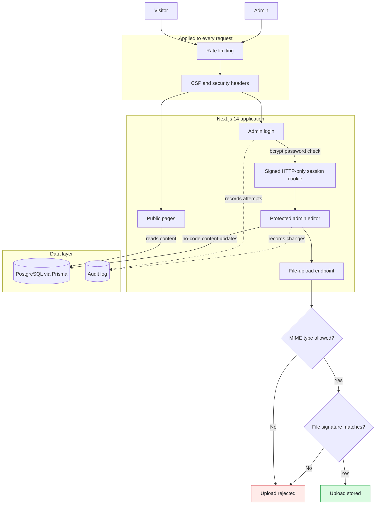


### Sovereign On-Premise Agentic AI Workbench

*Smart India Hackathon 2026, MRPL*

An air-gapped, self-hosted AI workbench for confidential industrial data, being built with zero external network calls and zero-trust principles. A multi-model backend auto-selects the right open-weight LLM per task, with local tool use, planning and OCR/vision.

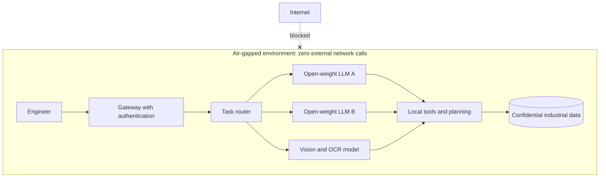


### SAT-SA: Supervisory Analytics Tool

*Final-year major project, Smart India Hackathon*

An offline, explainable analytics platform that assesses case-management and process data across Critical Sector Entities and highlights execution gaps. Guided by Dr. Rudresh Shirwaikar, Director of CSIT.

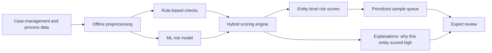

A risk score nobody can explain is a score nobody trusts, so every output ships with its reasoning.


### AI-Driven Pre-Transaction Fraud Risk Warning System for UPI

*Final-year team project*

Warns the user before the money moves. It analyzes payment messages, URLs, QR codes and transaction features, then gives an explainable Safe, Suspicious or High-Risk verdict. Backed by a review of 15 research papers across ML, GNN, NLP/BERT and deep learning for financial fraud detection. Guided by Dr. Rudresh Shirwaikar, Director of CSIT.

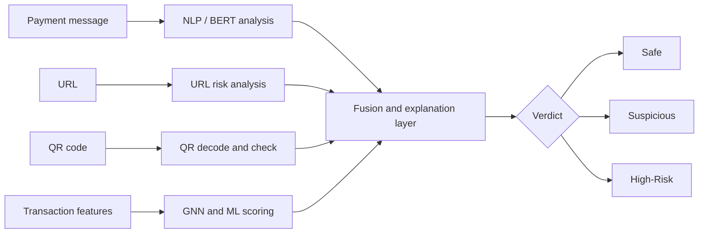


### Data Loss Prevention (DLP) System

*Endpoint agent, dashboard and ML detection*

An enterprise DLP prototype with a Windows endpoint agent, an admin dashboard and Active Directory-ready policy mapping, built during my R&D Lead internship at OffSecDiary.

- Per-device agent tokens so every endpoint is individually authenticated
- Real-time monitoring that flags unauthorized data movement
- An ML-based malicious-behavior detection module that cuts false positives in alerts

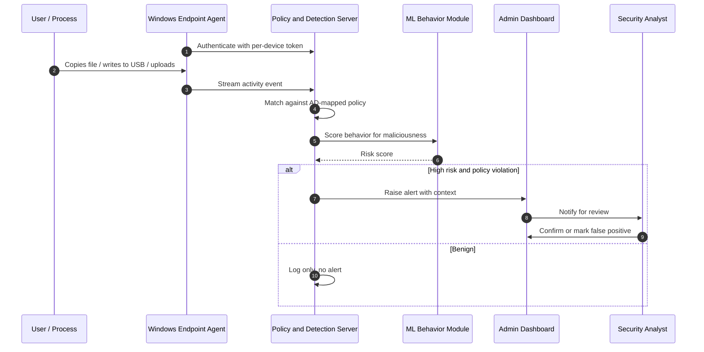

A rule-only DLP drowns analysts in noise. Scoring behavior before alerting is what keeps it usable.


### Symbiotic Chunk Storage (SCS)

*Secure distributed storage*

Distributed storage designed so no single node can read your data, no single failure can lose it, and deletion is provable.

- **Confidentiality:** AES-256-GCM encryption
- **Fault tolerance:** Reed-Solomon erasure coding
- **Integrity:** Merkle proofs plus cross-chain anchoring for tamper evidence
- **Resilience:** autonomous healing of lost shards
- **Compliance:** crypto-shredding for GDPR / HIPAA-aligned data deletion

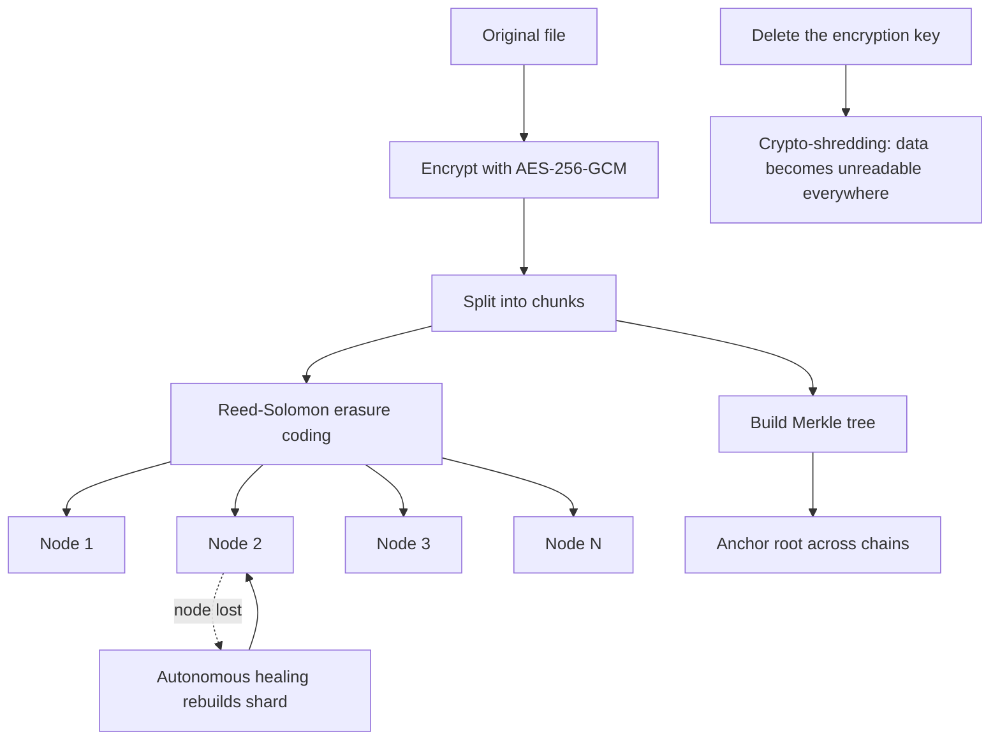


### Unified Operations Center

*Employee management system, team project*

A full-stack employee management platform built by a team using Next.js, React, TypeScript and MongoDB. I contributed to the calendar and event-tracking modules and the performance analytics dashboard, and to securing the platform with JWT in HTTP-only cookies, bcrypt hashing, role-based access control and input validation.

**How a request is guarded**

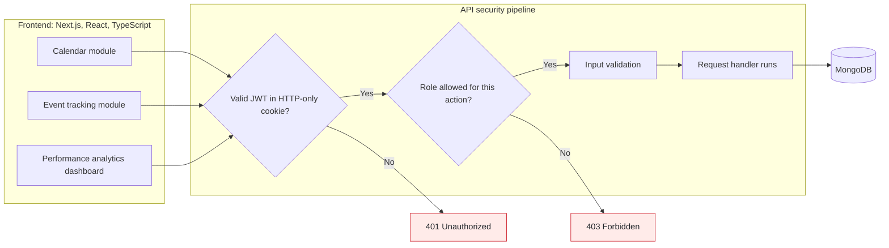

**How a user gets in**

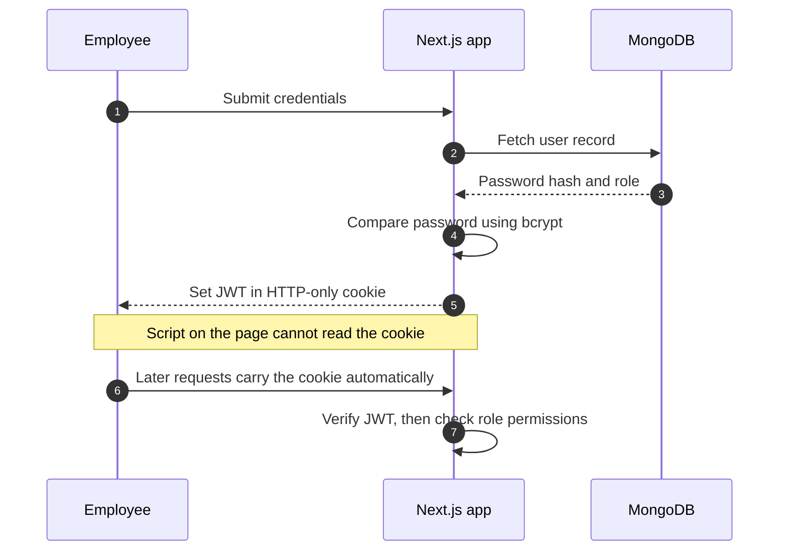


---

## Journey So Far

Internships, leadership roles and everything in between, in one place:

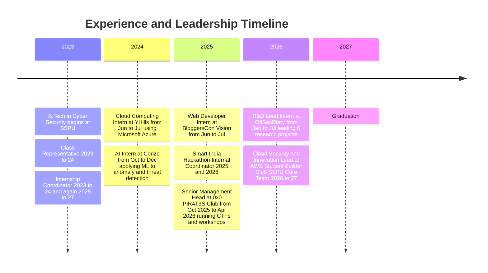

Off the timeline: I'm also a **Session Anchor** for SSPU conferences and events, and a volunteer on the **HICA SSPU Team**, which hosted a Low-Code/No-Code session.

### Academic Trajectory

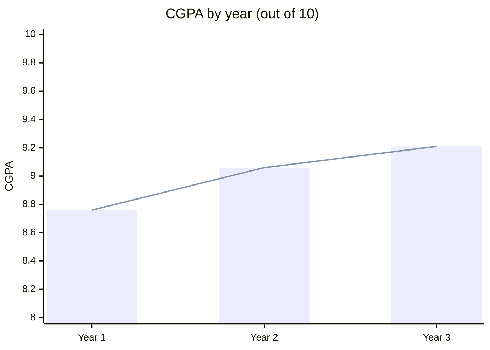

Each year better than the last. That is also how I approach every skill.

---

## CTF and Competition Record

| Event | Result |
|---|---|
| **X'PLOITATHON CTF 2026** | Qualified for Round 2 (Round 1: rank 11 of 175, Round 2: rank 22 of 50) |
| **Bypass CTF** | Ranked 20th |
| **MumbaiHacks** | Qualified for Round 2 |
| **TryHackMe** | Top 15% globally |

---

## Certifications and Learning Path

What I have finished, what I am working through now, and what I am picking up next:

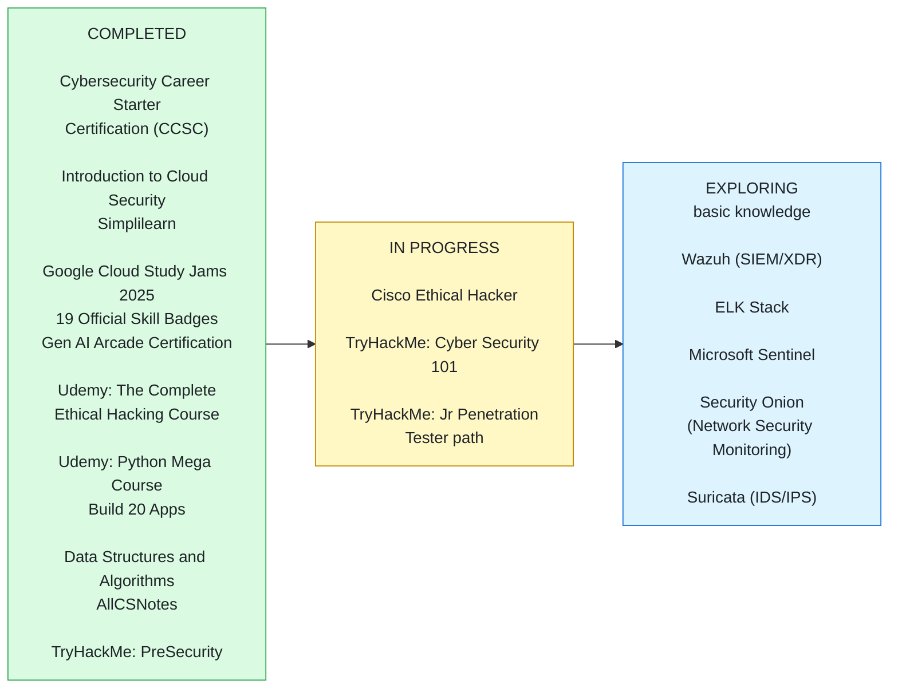

---

## `security.txt`

Because a security person's contact page should be a disclosure policy:

```text
Contact:     mailto:raveenasharma3921@gmail.com
Contact:     https://linkedin.com/in/raveena-sharma-csit
Expires:     2027-12-31T23:59:59.000Z
Preferred-Languages: en, hi
Canonical:   https://github.com/RS3921
Policy:      Internships, research collaboration, CTF teams and
             security-project ideas are all in scope.
Hiring:      Open to SOC / DFIR / VAPT internship opportunities.
```

---

<div align="center">

```text
 [ detect ]  ->  [ investigate ]  ->  [ respond ]  ->  [ build it better ]
```

*Every incident is a lesson. Every lesson becomes a detection rule.*

</div>
