<div align="center">

```text
 ____   ____   _____   ___   ____   _ 
|  _ \ / ___| |___ /  / _ \ |___ \ / |
| |_) |\___ \   |_ \ | (_) |  __) || |
|  _ <  ___) | ___) | \__, | / __/ | |
|_| \_\|____/ |____/    /_/ |_____||_|
   > security operations // investigations // detection
```

# Raveena Sharma

**Security Operations Intern · Investigations · Vulnerability Management · Threat Management**


[LinkedIn](https://linkedin.com/in/raveena-sharma-csit) · [TryHackMe](https://tryhackme.com/p/raveenasharma392) · [Email](mailto:raveenasharma3921@gmail.com)

</div>

---

## `$ whoami`

Final-year B.Tech (Cyber Security) student in Pune who thinks like a defender and tests like an attacker. I triage alerts, chase evidence through logs and disk images, break things with VAPT tooling, and then build the systems that would have stopped it.

Instead of a bullet list of adjectives, here is my profile as code:

```python
from dataclasses import dataclass, field

@dataclass
class Analyst:
    name: str = "Raveena Sharma"
    base: str = "Pune, India"
    degree: str = "B.Tech CS&IT (Cyber Security), SSPU, 2027"
    cgpa: float = 9.0
    thm_rank: str = "Top 15% globally"
    toolbox: dict = field(default_factory=lambda: {
        "investigate": ["Autopsy", "FTK Imager", "Wireshark", "Windows Event Logs"],
        "assess":      ["Nessus", "Nmap", "Burp Suite", "OWASP ZAP", "Metasploit"],
        "detect":      ["Splunk", "VirusTotal", "AbuseIPDB", "MITRE ATT&CK", "IDS/IPS"],
        "build":       ["Python", "TypeScript", "Next.js", "PostgreSQL", "MongoDB"],
    })

    def triage(self, alert):
        """Enrich -> map to ATT&CK -> decide: close, escalate, or contain."""
        ioc = self.enrich(alert, sources=["VirusTotal", "AbuseIPDB"])
        return self.map_to_attack(ioc).verdict()

    def investigate(self, incident):
        """Preserve evidence first. Always. Then timeline, then conclusions."""
        image = self.acquire(incident, tool="FTK Imager")
        return self.analyze(image, tool="Autopsy").build_timeline()

    def assess(self, target):
        """Scan, validate manually, rate the risk, write it so a human can act on it."""
        findings = self.scan(target, tools=["Nmap", "Nessus"]).validate(by_hand=True)
        return findings.rank_by_risk().write_report()

    def hunt(self, hypothesis):
        """Start from a TTP, not from an alert."""
        return self.query_siem(hypothesis, platform="Splunk").pivot_on_iocs()

    def build(self, problem):
        """If the tool I need does not exist, I make a prototype."""
        return self.prototype(problem, security_by_design=True)

    def learn(self):
        while True:
            self.practice(["TryHackMe: Jr Pentester", "Cisco Ethical Hacker"])
            self.explore(["Wazuh", "ELK", "Sentinel", "Security Onion", "Suricata"])

me = Analyst()
```

---

## Case File: RS-3921

| Field | Detail |
|---|---|
| **Subject** | Raveena Sharma |
| **Role sought** | Security Operations Internship (Investigations / Vulnerability Mgmt / Threat Mgmt) |
| **Last role** | R&D Lead Intern, OffSecDiary (led 6 research projects over 7 months) |
| **Known techniques** | Alert triage, DFIR, VAPT, SIEM querying, threat hunting fundamentals |
| **Known aliases** | R&D Lead, Cloud Security & Innovation Lead, Senior Management Head |
| **Weakness** | Cannot leave a half-finished lab unsolved |
| **Status** | Active. Learning. Shipping. |

---

## My Alert Triage Pipeline

How I work an alert, from first signal to a decision someone can act on:

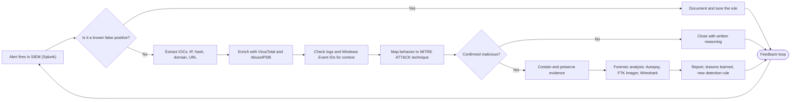

---

## Skills Mapped to the Attack Lifecycle

I organize what I know the way an adversary operates, so every skill answers a real question: *where does this stop the attacker?*

| Phase | Question I answer | What I use |
|---|---|---|
| **Reconnaissance** | What does the attacker see? | Nmap, Kali Linux, DNS / TCP-IP fundamentals |
| **Vulnerability discovery** | What can be exploited? | Nessus, Burp Suite, OWASP ZAP, OWASP Top 10 |
| **Exploitation** | Is it really exploitable? | Metasploit, Hydra, John the Ripper, Hashcat |
| **Detection** | Can we see it happening? | Splunk, IDS/IPS, MITRE ATT&CK, IOC/IOA/TTP analysis |
| **Investigation** | What actually happened? | Autopsy, FTK Imager, Wireshark, Windows Event Analysis |
| **Response** | How do we contain and recover? | Incident response, alert triage, evidence preservation |
| **Prevention** | How do we stop it next time? | DLP, Zero Trust, Secure SDLC, GDPR / PCI-DSS / HIPAA / DPDP |

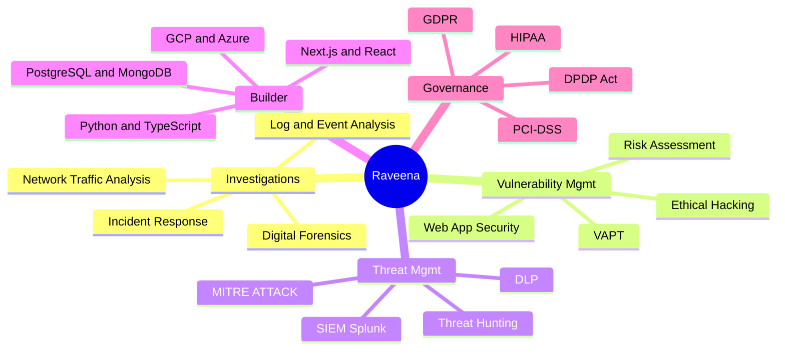

---

## Featured Builds

Security work that ships as code, not slides. Each project below is expandable.

<details>
<summary><b>Data Loss Prevention (DLP) System</b> &nbsp;|&nbsp; endpoint agent + dashboard + ML detection</summary>

<br>

An enterprise DLP prototype with a Windows endpoint agent, an admin dashboard, and Active Directory-ready policy mapping. Built during my R&D Lead internship at OffSecDiary.

**What it does**
- Per-device agent tokens so every endpoint is individually authenticated
- Real-time monitoring that flags unauthorized data movement
- ML-based malicious-behavior detection that cuts false positives in alerts

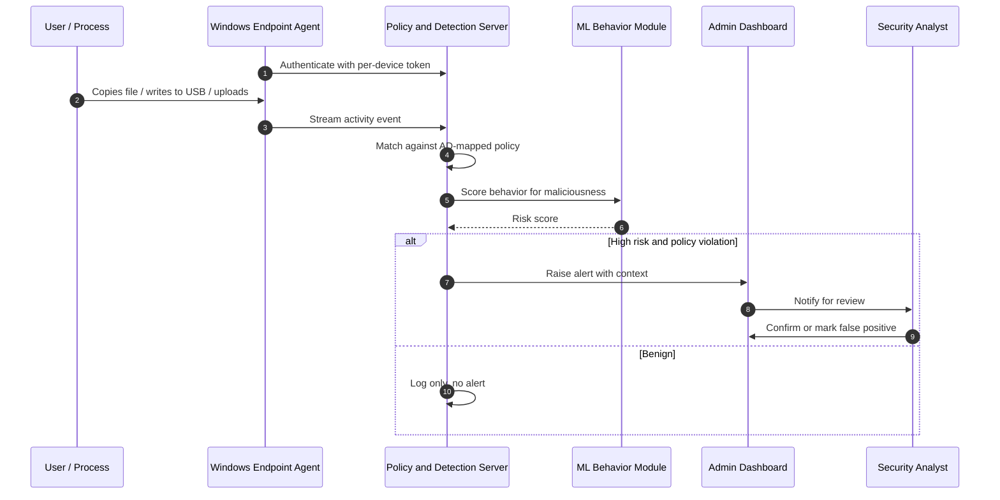

**Why the ML layer matters:** a rule-only DLP drowns analysts in noise. Scoring behavior before alerting is what makes the tool usable at 3 AM.

</details>

<details>
<summary><b>Symbiotic Chunk Storage (SCS)</b> &nbsp;|&nbsp; secure distributed storage</summary>

<br>

Distributed storage designed so that no single node can read your data, no single failure can lose it, and deletion is provable.

- **Confidentiality:** AES-256-GCM encryption
- **Fault tolerance:** Reed-Solomon erasure coding
- **Integrity:** Merkle proofs plus cross-chain anchoring for tamper evidence
- **Resilience:** autonomous healing of lost shards
- **Compliance:** crypto-shredding for GDPR / HIPAA-aligned deletion

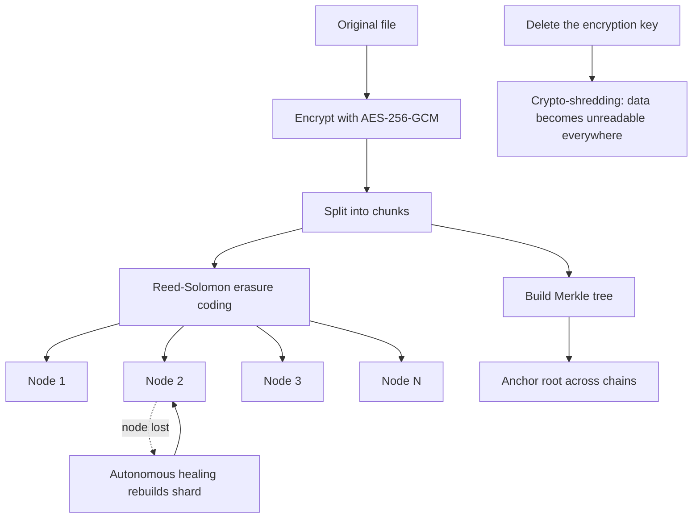

</details>

<details>
<summary><b>SAT-SA: Supervisory Analytics Tool</b> &nbsp;|&nbsp; Final-year major project, Smart India Hackathon</summary>

<br>

An offline, explainable analytics platform that assesses case-management and process data across Critical Sector Entities and highlights execution gaps. Guided by Dr. Rudresh Shirwaikar, Director of CSIT.

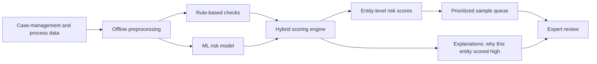

**Design principle:** a risk score nobody can explain is a score nobody trusts. Every output ships with its reasoning.

</details>

<details>
<summary><b>AI-Driven Pre-Transaction Fraud Risk Warning System for UPI</b></summary>

<br>

Stops the user before the money moves. Analyzes payment messages, URLs, QR codes and transaction features, then gives an explainable verdict. Backed by a review of 15 research papers across ML, GNN, NLP/BERT and deep learning for financial fraud detection.

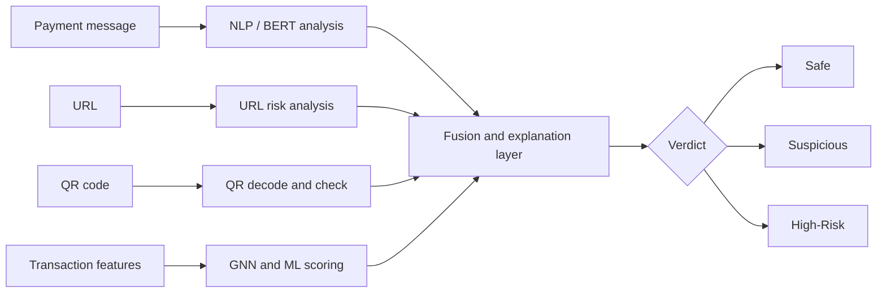

</details>

<details>
<summary><b>Sovereign On-Premise Agentic AI Workbench</b> &nbsp;|&nbsp; Smart India Hackathon 2026, MRPL</summary>

<br>

An air-gapped, self-hosted AI workbench for confidential industrial data. Zero external network calls, designed on zero-trust principles.

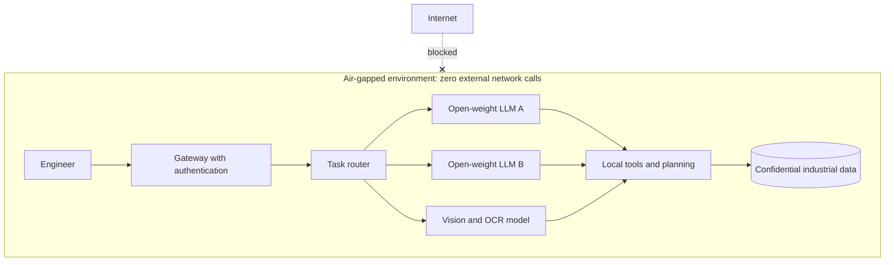

The router auto-selects the right model per task, so you get capability without sending a single byte outside the plant.

</details>

<details>
<summary><b>Secure Web Applications</b> &nbsp;|&nbsp; Cybersecurity Portfolio and Unified Operations Center</summary>

<br>

Two full-stack apps where security was a requirement from commit one, not a patch at the end. Stack: Next.js, React, TypeScript, PostgreSQL (Prisma) and MongoDB.

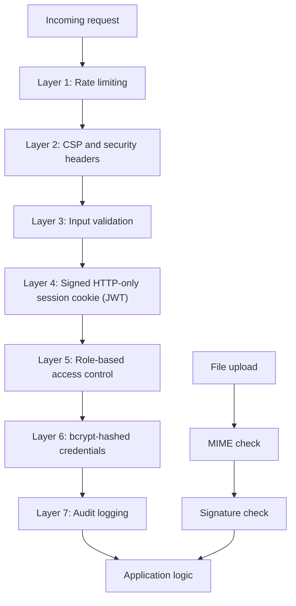

</details>

---

## Journey So Far

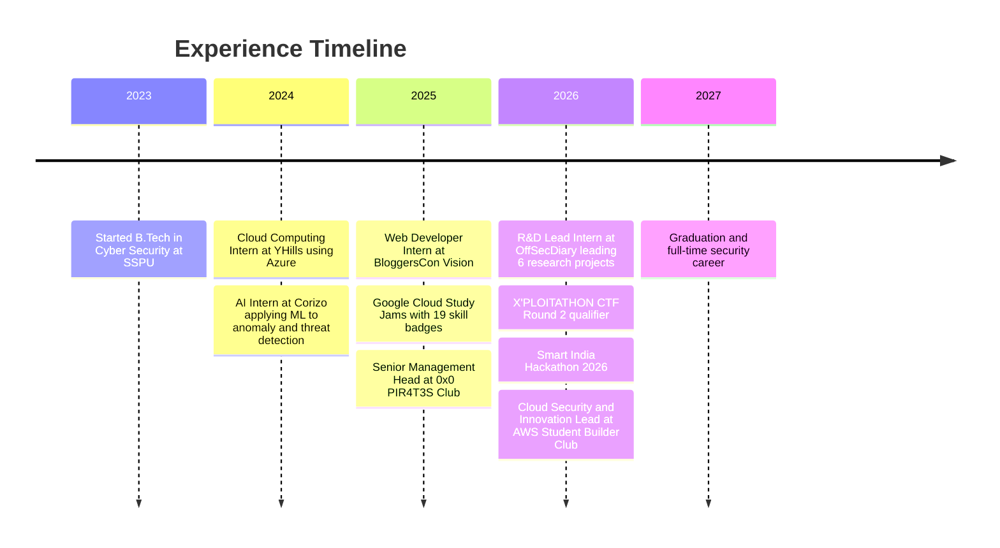

### Academic Trajectory

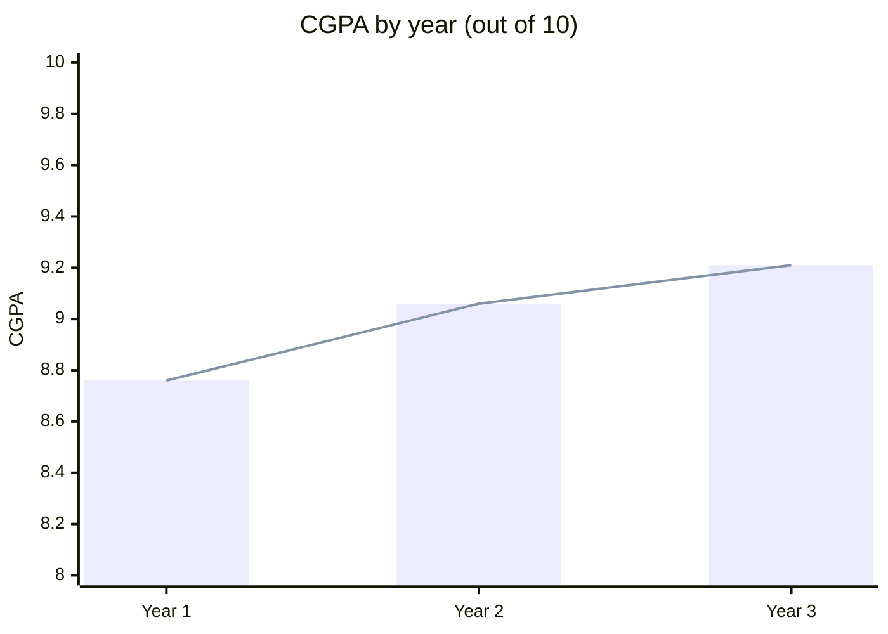

Each year better than the last. That is also how I approach every skill.

---

## CTF and Competition Record

| Event | Result |
|---|---|
| **X'PLOITATHON CTF 2026** | Qualified for Round 2 (Round 1: rank 11 of 175, Round 2: rank 22 of 50) |
| **Bypass CTF** | Ranked 20th |
| **MumbaiHacks** | Qualified for Round 2 |
| **TryHackMe** | Top 15% globally |

---

## Currently Leveling Up

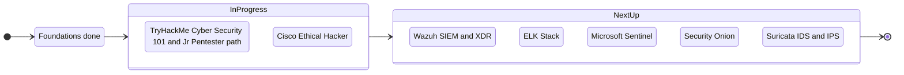

**Certifications:** CCSC · Introduction to Cloud Security (Simplilearn) · Google Cloud Study Jams 2025 (19 skill badges + Gen AI Arcade) · Cisco Ethical Hacker (in progress) · Udemy Ethical Hacking · TryHackMe PreSecurity

---

## Beyond the Terminal

- **Cloud Security & Innovation Lead**, AWS Student Builder Club, SSPU Core Team (2026-27): cloud-security projects, workshops and hands-on sessions
- **Senior Management Head**, 0x0 PIR4T3S Club (Oct 2025 - Apr 2026): ran operations and events for a cybersecurity community, including CTFs and workshops
- **Internship Coordinator** and **Smart India Hackathon Internal Coordinator**: connecting students with real opportunities
- **Session Anchor** for SSPU conferences, because explaining security to a room is part of the job too

---

## `security.txt`

Because a security person's contact page should be a disclosure policy:

```text
Contact:     mailto:raveenasharma3921@gmail.com
Contact:     https://linkedin.com/in/raveena-sharma-csit
Expires:     2027-12-31T23:59:59.000Z
Preferred-Languages: en, hi
Canonical:   https://github.com/RS3921
Policy:      Internships, research collaboration, CTF teams and
             security-project ideas are all in scope.
Hiring:      Open to SOC / DFIR / VAPT internship opportunities.
```

---

<div align="center">

```text
 [ detect ]  ->  [ investigate ]  ->  [ respond ]  ->  [ build it better ]
```

*Every incident is a lesson. Every lesson becomes a detection rule.*

</div>
