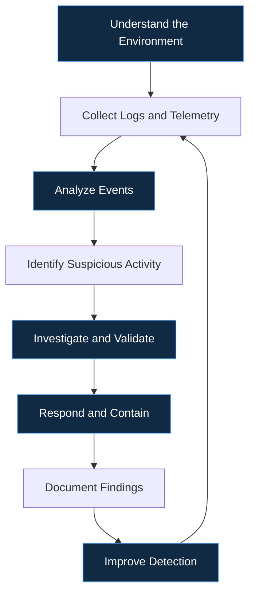

# Hi, I'm Raveena Sharma

### Cybersecurity Enthusiast | Cloud Security | SOC & Threat Detection | AI/ML

**Final-year B.Tech Computer Science and IT (Cybersecurity) student** at Symbiosis Skills and Professional University, Pune, with a 9.0 CGPA.

I enjoy exploring cybersecurity, building practical projects, researching security challenges, and developing secure and innovative solutions. My interests span Security Operations Centers, cloud security, threat detection, digital forensics, and AI-driven security.

- Working as **Cloud Security and Innovation Lead at the AWS Student Builder Club**
- Former **Senior Management Head at 0x0 PIR4T3S Cybersecurity Club**
- Experience across cybersecurity research, cloud computing, AI/ML, and web development
- Passionate about hands-on learning, teamwork, technical problem-solving, and continuous improvement
- Goal: Build practical AWS cloud security solutions and prepare for the AWS Certified Security – Specialty certification

---

## About Me

I am a cybersecurity student who believes in learning by building, experimenting, and solving real-world problems. Through internships, research, projects, and student communities, I have explored different areas of technology and security.

My focus is on strengthening my technical foundation while building practical skills in security monitoring, cloud protection, vulnerability assessment, and security automation.

**What drives me:**

- Building secure and reliable technology
- Understanding how attacks happen and how to detect and prevent them
- Exploring the intersection of AI and cybersecurity
- Collaborating with people who enjoy learning and building
- Sharing knowledge and contributing to the cybersecurity community

---

## Technical Skills

### Cybersecurity & SOC Operations

- SIEM and security monitoring fundamentals
- Log analysis, alert triage, and incident response fundamentals
- Threat detection and threat hunting fundamentals
- MITRE ATT&CK, IDS/IPS, and network traffic analysis
- Vulnerability assessment and penetration testing
- Digital forensics, cryptography, and data loss prevention
- OWASP Top 10 and secure development fundamentals

### Cloud Security & DevOps

- Cloud security fundamentals and IAM concepts
- Microsoft Azure cloud infrastructure fundamentals
- AWS security services and cloud monitoring concepts
- Docker, Git, and CI/CD security fundamentals

### Programming & Web Development

### Databases & Development Tools

---

## Featured Projects

### 1. Symbiotic Chunk Storage

A project focused on distributed, chunk-based data storage and a database-backed application.

**Technologies:** Python, MongoDB, web technologies

[Explore the repository](https://github.com/RS3921/Symbiotic-Chunk-Storage)

### 2. Data Loss Prevention (DLP)

A cybersecurity project focused on protecting sensitive information, encryption, and access control.

**Focus:** Data protection, cryptography, secure data handling

[Explore the repository](https://github.com/RS3921/DLP-Project)

### 3. SAT-SA SOC Project

An AI-assisted Security Operations Center project exploring the use of language models in security analysis and threat detection.

**Focus:** SOC workflows, AI/ML, security analysis

### 4. Cybersecurity Research & Practical Labs

Hands-on exploration of security monitoring, vulnerability assessment, network analysis, digital forensics, and threat detection.

I continue to expand this portfolio as I develop new tools, complete practical exercises, and build security-focused applications.

---

## How I Approach Cybersecurity

My approach combines technical investigation, structured analysis, documentation, and continuous improvement.

---

## Experience & Leadership

### Cloud Security and Innovation Lead
**AWS Student Builder Club | SSPU**

- Contribute to cloud security learning and technical initiatives.
- Explore AWS services and practical cloud-based solutions.
- Encourage collaboration, experimentation, and peer learning.

### Senior Management Head
**0x0 PIR4T3S Cybersecurity Club**

- Contributed to cybersecurity events, workshops, and community initiatives.
- Supported event coordination and student engagement.
- Helped create opportunities for practical cybersecurity learning.

### Internship Experience

**Cybersecurity Research & Development**
- Contributed to cybersecurity research and hands-on project development.
- Explored security problems and practical technical solutions.

**Cloud Computing**
- Worked with Microsoft Azure and cloud infrastructure fundamentals.

**AI/ML**
- Explored machine learning concepts and their practical applications.

**Web Development**
- Worked with web technologies, WordPress, and application development.

---

## Current Learning Goals

I am continuously building on my cybersecurity foundation through practical projects and structured learning.

- **Cloud Security:** AWS IAM, CloudTrail, GuardDuty, and Security Hub
- **SOC & Threat Hunting:** Security event analysis, investigation, and detection logic
- **Security Automation:** Python scripting for repetitive security tasks
- **AI for Cybersecurity:** Exploring AI/ML applications in security analysis
- **Malware Analysis:** Developing practical defensive analysis skills

### My AWS Goal

Build a practical AWS cloud security monitoring project that combines IAM, CloudTrail, GuardDuty, and Security Hub to explore identity monitoring, threat detection, and investigation workflows.

My longer-term goal is to prepare for the **AWS Certified Security – Specialty** certification.

---

## GitHub Analytics

### Contribution Activity

---

## Let's Connect

I enjoy connecting with cybersecurity enthusiasts, cloud engineers, developers, and researchers who are passionate about building secure and meaningful technology.

- **GitHub:** [RS3921](https://github.com/RS3921)
- **LinkedIn:** [RS3921](https://www.linkedin.com/in/raveena-sharma-csit/)
- **Email:** [RS3921](raveenasharma3921@gmail.com)

---

*Learn continuously. Build practically. Secure by design.*
