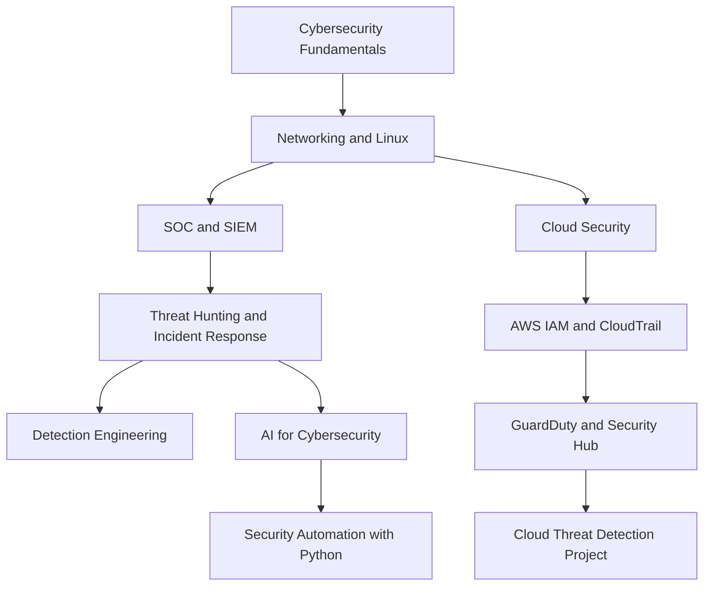

# Hi, I'm Raveena Sharma

### Cybersecurity | Cloud Security | SOC & Threat Detection | AI/ML

Final-year B.Tech Computer Science and IT (Cybersecurity) student at Symbiosis Skills and Professional University, Pune, with a 9.0 CGPA.

I am passionate about cybersecurity, cloud security, threat detection, and building secure and innovative solutions. I enjoy hands-on learning, solving security challenges, researching emerging threats, and exploring how AI can improve security operations.

- Currently serving as **Cloud Security and Innovation Lead at the AWS Student Builder Club**
- Former **Senior Management Head at 0x0 PIR4T3S**
- Experienced in cybersecurity research, cloud computing, AI/ML, and web development
- Interested in SOC operations, threat hunting, digital forensics, and cloud security
- Currently working towards stronger AWS security skills and practical cloud security projects

---

## Technical Skills

### Cybersecurity & SOC

SIEM | Log Analysis | Alert Triage | Incident Response Fundamentals | Threat Detection | MITRE ATT&CK | VAPT | Network Security | Digital Forensics | DLP | OWASP Top 10

### Cloud & DevOps

Cloud Security Fundamentals | IAM Concepts | Secure Deployment | CI/CD Security Fundamentals

### Programming & Development

### Databases & Other Tools

---

## Featured Projects

### 1. Symbiotic Chunk Storage

A secure distributed storage project focused on chunk-based data storage and access control.

**Technologies:** Python, MongoDB, Web Development, Security

[View Repository](https://github.com/RS3921/Symbiotic-Chunk-Storage)

### 2. Data Loss Prevention (DLP) Project

A security-focused project exploring data protection, encryption, and controlled access to sensitive information.

**Focus:** Data Security, Encryption, Access Control

[View Repository](https://github.com/RS3921/DLP-Project)

### 3. SAT-SA SOC Project

An AI-assisted Security Operations Center project exploring the use of language models for security analysis and threat detection.

**Focus:** SOC Operations, AI/ML, Security Analysis

### 4. Cybersecurity Labs & Research

Hands-on learning across network analysis, vulnerability assessment, security monitoring, digital forensics, and threat detection.

More projects and implementations will be added as I continue learning and building.

[Explore All My Repositories](https://github.com/RS3921?tab=repositories)

---

## My Learning Roadmap

I believe in learning cybersecurity through practical implementation, experimentation, and continuous research.

### Currently Exploring

- AWS cloud security and identity management
- CloudTrail-based monitoring and threat investigation
- GuardDuty findings and cloud threat detection
- SOC workflows, SIEM investigations, and detection logic
- Python automation for security tasks
- Malware analysis and defensive security research
- AI/ML applications in cybersecurity

### My AWS Goal

Build a practical AWS cloud security monitoring project using IAM, CloudTrail, GuardDuty, and Security Hub, and prepare for the AWS Certified Security – Specialty certification.

---

## Experience & Leadership

### Cloud Security and Innovation Lead
**AWS Student Builder Club | SSPU**

Contributing to cloud security learning, technical initiatives, practical projects, and collaboration within the student builder community.

### Senior Management Head
**0x0 PIR4T3S Cybersecurity Club**

Contributed to club operations, cybersecurity events, workshops, and community learning initiatives.

### Internship Experience

- **Cybersecurity Research & Development:** Research, project development, and cybersecurity problem-solving.
- **Cloud Computing:** Cloud infrastructure and security fundamentals using Microsoft Azure.
- **AI/ML:** Applied machine learning concepts and explored security-related applications.
- **Web Development:** Worked with web technologies and frameworks to build and improve web applications.

---

## GitHub Analytics

### Contribution Activity

---

## Let's Connect

I am always interested in connecting with cybersecurity enthusiasts, cloud engineers, researchers, and fellow builders to exchange knowledge and collaborate on meaningful projects.

- **GitHub:** [RS3921](https://github.com/RS3921)
- **LinkedIn:** Add your LinkedIn profile URL here
- **Email:** Add your professional email address here

---

*Learn continuously. Build practically. Secure by design.*
